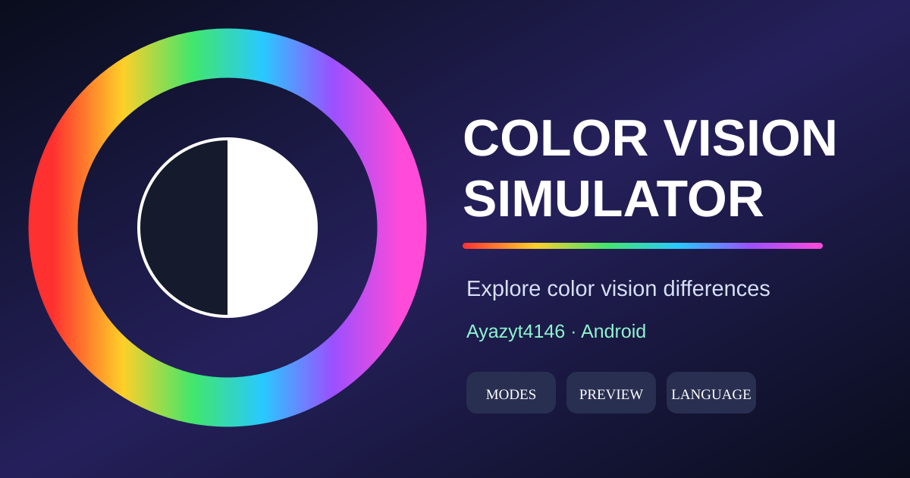

# Color Vision Simulator

An Android app by **Ayazyt4146** for exploring color-vision simulations.

- Turkish and English interface switch
- Protanopia, protanomaly, deuteranopia, deuteranomaly, tritanopia, tritanomaly
- Achromatopsia (grayscale approximation) and achromatomaly preview
- System-wide Android filter when the device supports it and the required system permission is granted

**Important:** Android/OEM support varies. Some modes are in-app approximations and are not medical tools or diagnostic tests. A floating Minecraft overlay is not included yet.
